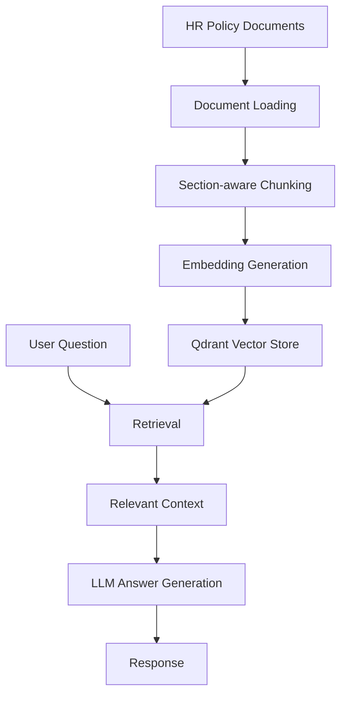

# Enterprise HR RAG Assistant

An experimental Retrieval-Augmented Generation (RAG) system for answering employee questions using internal HR policy documents.

The project explores document ingestion, section-aware chunking, embeddings, vector storage, retrieval strategies, and systematic retrieval evaluation.

## 1. Project Overview

Employees often need to search through internal HR policies to find information about annual leave, remote work, and expense reimbursement.

This project explores how a RAG-based assistant can retrieve relevant policy sections and use them as context for generating answers.

### Key Features

- Markdown document ingestion
- Section-aware document chunking
- Embedding generation through the AvalAI API
- Local vector storage using Qdrant
- Vector-based retrieval and RAG components
- Offline BM25 retrieval evaluation
- Experiments with hybrid ranking
- Rule-based query expansion
- Evaluation of retrieval quality and generalization

## 2. Architecture



The system separates document ingestion, storage, retrieval, and answer generation into independent components.

This makes it easier to evaluate retrieval approaches and experiment with improvements without tightly coupling the entire pipeline.

## 3. Technology Stack

| Component | Technology |
|---|---|
| Programming Language | Python 3.11 |
| Embedding API | AvalAI (OpenAI-compatible API) |
| Embedding Model | text-embedding-3-small |
| Vector Database | Qdrant |
| LLM Integration | OpenAI-compatible API |
| Retrieval Experiments | BM25, Hybrid Ranking, Query Expansion |
| Document Format | Markdown |
| Configuration | python-dotenv |

## 4. Knowledge Base

The current knowledge base contains three HR policy documents:

| Document ID | Document |
|---|---|
| HR-001 | Leave Policy |
| HR-002 | Remote Work Policy |
| HR-003 | Expense Reimbursement Policy |

Documents are split into meaningful sections rather than being stored as single large text blocks.

The current dataset produces **11 chunks** across the three documents.

Section-aware chunking preserves the relationship between each piece of information and its original policy section.

## 5. Retrieval Experiments

Three retrieval approaches were investigated.

### BM25

A lexical retrieval baseline based on term frequency and inverse document frequency.

BM25 can perform well when question wording overlaps with the source text, but may struggle with paraphrases and synonyms.

### Hybrid Ranking

A ranking approach combining BM25 content relevance with an additional section-title relevance score.

The experiment investigates whether title information can improve the ranking of relevant policy sections.

### Rule-based Query Expansion

A query expansion approach that adds related policy terminology to the original question based on detected intent.

The goal is to improve retrieval when users phrase questions differently from the source documents.

## 6. Evaluation

Retrieval performance is measured using the following metrics:

- **Hit Rate@1:** Percentage of questions for which the expected section appears at rank 1.
- **Hit Rate@3:** Percentage of questions for which the expected section appears within the top 3 results.
- **MRR@3:** Mean Reciprocal Rank, measuring the ranking position of the expected section within the top 3 results.

### Final Evaluation Results

The final evaluation dataset contains 30 questions.

| Method | Hit Rate@1 | Hit Rate@3 | MRR@3 |
|---|---:|---:|---:|
| BM25 | 53.33% | 73.33% | 0.6278 |
| Hybrid Ranking | 53.33% | 73.33% | 0.6278 |
| Rule-based Query Expansion | 53.33% | 73.33% | 0.6278 |

### Observations

- All three methods achieved identical results on the final evaluation set.
- Hybrid ranking did not improve retrieval over the BM25 baseline on this dataset.
- The query expansion rules did not detect an applicable intent in the 30 final questions.
- Eight questions did not retrieve their expected section within the top three results.

These findings highlight the limitations of lexical retrieval and manually defined intent rules when handling diverse natural-language questions.

**Evaluation limitation:** The evaluation datasets were created during project development, and earlier experiments influenced subsequent query and rule design. Therefore, these results should be treated as development-stage evaluation rather than an independent benchmark.

## 7. Project Structure

```text
enterprise-hr-rag/
├── data/
│   ├── documents/
│   │   ├── expense_reimbursement_policy.md
│   │   ├── leave_policy.md
│   │   └── remote_work_policy.md
│   ├── evaluation/
│   │   ├── answerability_questions.json
│   │   ├── answer_quality_questions.json
│   │   ├── final_test_questions.json
│   │   ├── generalization_questions.json
│   │   ├── retrieval_questions.json
│   │   └── sample_answers.json
│   └── qdrant/                  # Generated locally
├── src/
│   ├── __init__.py
│   ├── chunking.py
│   ├── embeddings.py
│   ├── ingest.py
│   ├── vector_store.py
│   ├── search.py
│   ├── rag.py
│   ├── evaluate_retrieval.py
│   ├── evaluate_bm25.py
│   ├── evaluate_hybrid.py
│   ├── evaluate_query_expansion.py
│   ├── evaluate_generalization.py
│   ├── evaluate_final_test.py
│   ├── evaluate_answers.py
│   ├── evaluate_answer_quality.py
│   ├── evaluate_offline.py
│   ├── experiment_query_expansion.py
│   └── inspect_generalization_failures.py
├── tests/
│   └── __init__.py
├── .env.example
├── .gitignore
├── requirements.txt
└── README.md
```

The local Qdrant database is generated during ingestion and is not included in version control.

## 8. Setup

### Prerequisites

- Python 3.11+
- An AvalAI API key

### Clone the repository

```bash
git clone https://github.com/parisa69eng/enterprise-hr-rag.git
cd enterprise-hr-rag
```

### Create and activate a virtual environment

```bash
python3 -m venv .venv
source .venv/bin/activate
```

### Install dependencies

```bash
python -m pip install -r requirements.txt
```

### Configure environment variables

Create a local `.env` file from the example:

```bash
cp .env.example .env
```

Add your own AvalAI API key to `.env`:

```env
AVALAI_API_KEY=your_api_key
AVALAI_BASE_URL=https://api.avalai.ir/v1
EMBEDDING_MODEL=text-embedding-3-small
LLM_MODEL=gpt-4o-mini
```

Never commit your actual API key or `.env` file to version control.

## 9. Running the Project

### Initialize the vector store

```bash
python -m src.vector_store
```

### Ingest documents

```bash
python -m src.ingest
```

This step reads the Markdown policies, splits them into sections, generates embeddings through the external API, and stores the resulting vectors and payloads in the local Qdrant database.

**Note:** Ingestion requires a valid API key and may incur API costs. It only needs to be repeated when the source documents or chunking process change.

### Run retrieval evaluation

The following evaluation scripts use locally stored document chunks and do not require new embedding API calls.

BM25 baseline:

```bash
python -m src.evaluate_bm25
```

Hybrid ranking:

```bash
python -m src.evaluate_hybrid
```

Query expansion:

```bash
python -m src.evaluate_query_expansion
```

Generalization evaluation:

```bash
python -m src.evaluate_generalization
```

Final evaluation:

```bash
python -m src.evaluate_final_test
```

The vector-based search and RAG components use the configured API for query embeddings and answer generation.

## 10. Limitations and Future Improvements

This project is an experimental prototype, not a production-ready HR assistant.

Current limitations include:

- A small knowledge base containing only three policy documents.
- Limited evaluation dataset size.
- Manually defined query expansion rules.
- No independent, externally validated benchmark.
- No deployed web interface, user authentication, or production monitoring.

Potential future improvements:

- Semantic and hybrid retrieval evaluation.
- Cross-encoder reranking.
- More robust query understanding and expansion.
- Improved answer grounding and citation generation.
- Larger and more diverse evaluation datasets.
- Automated evaluation of answer faithfulness and relevance.
- A web interface for interactive use.

## 11. Author

**Parisa Khatibi Damavandi**

- [GitHub](https://github.com/parisa69eng)
- [LinkedIn](https://www.linkedin.com/in/parisa-khatibi-damavandi/)
